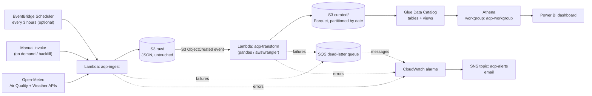

# AWS Air Quality & Weather Batch Pipeline

A serverless, cloud-native batch data pipeline on AWS that ingests hourly air quality and weather data for 8 Indian cities from the open-source Open-Meteo APIs, stores it in a partitioned Parquet data lake on S3, and serves analyst-ready SQL views through Athena and a Power BI dashboard.

Everything is defined as code. The Lambda functions, IAM roles, schedule, alarms, Glue database and Athena workgroup all live in this repository and are deployed with AWS SAM. Nothing is created by hand in the AWS console except the alert email subscription and a read-only dashboard user.

> **Region:** ap-south-2 (Hyderabad) | **Runtime:** Python 3.12 | **IaC:** AWS SAM (CloudFormation)

---

## Table of contents

1. [Business problem](#1-business-problem)
2. [Architecture](#2-architecture)
3. [Tech stack](#3-tech-stack)
4. [How the code in AWS maps to this repo](#4-how-the-code-in-aws-maps-to-this-repo)
5. [Repository structure](#5-repository-structure)
6. [Data model](#6-data-model)
7. [Design decisions](#7-design-decisions)
8. [Prerequisites](#8-prerequisites)
9. [Deploy and run](#9-deploy-and-run)
10. [Operating the pipeline](#10-operating-the-pipeline)
11. [Dashboard (Power BI)](#11-dashboard-power-bi)
12. [Monitoring and reliability](#12-monitoring-and-reliability)
13. [Security](#13-security)
14. [Cost](#14-cost)
15. [Limitations](#15-limitations)
16. [Roadmap](#16-roadmap)
17. [Teardown](#17-teardown)
18. [Data source and attribution](#18-data-source-and-attribution)

---

## 1. Business problem

Logistics firms, outdoor retailers, event organisers and clinics are affected by air pollution and weather, but they rarely have this data in a form they can query. This project builds the data foundation that lets a data analyst or business owner answer questions such as:

| # | Business question | Answered by |
|---|---|---|
| 1 | Which cities had unhealthy air (US AQI above 100) most often? | `v_daily_city_aqi` |
| 2 | Which hours of the day are riskiest for outdoor deliveries? | `v_worst_hours` |
| 3 | How do rain and temperature relate to air quality? | `v_rain_vs_aqi`, `v_temp_vs_aqi` |

**Audience:** data analysts (SQL over Athena) and business owners (Power BI dashboard).

---

## 2. Architecture



**Flow in one paragraph:** a run of `aqp-ingest` (scheduled or manual) calls both Open-Meteo APIs for each of 8 cities and writes the untouched JSON to `raw/`. Every new raw file triggers `aqp-transform` through an S3 event. The transform flattens the data to one row per city per hour, enforces types, removes forecast hours, adds an AQI category and writes Parquet to `curated/`. Athena reads the Parquet through Glue tables with partition projection, and a set of layered SQL views deduplicates the data and answers the business questions.


---

## 3. Tech stack

| Layer | Tools |
|---|---|
| Ingestion | AWS Lambda (Python 3.12), Amazon EventBridge Scheduler, Open-Meteo REST APIs |
| Storage | Amazon S3 (raw JSON zone, curated Parquet zone) |
| Transformation | AWS Lambda, pandas, AWS SDK for pandas (awswrangler) managed layer, PyArrow |
| Catalog and query | AWS Glue Data Catalog, Amazon Athena (partition projection, views) |
| Visualisation | Power BI Desktop via the Athena ODBC driver |
| Reliability | Amazon SQS (dead-letter queue), Amazon SNS, Amazon CloudWatch alarms and logs |
| Infrastructure as code | AWS SAM / CloudFormation |
| Security | IAM least-privilege roles, S3 encryption and public access block |

---

## 4. How the code in AWS maps to this repo

The repository is the source of truth, and AWS is only where the code is deployed. Nothing is pasted into the console.

| Running in AWS | Defined in this repo |
|---|---|
| Lambda `aqp-ingest` | `src/ingest/app.py`, declared in `infra/template.yaml` |
| Lambda `aqp-transform` | `src/transform/app.py`, declared in `infra/template.yaml` |
| Shared config (cities, API URLs, variables) | `src/common/config.py` |
| S3 bucket, IAM roles, schedule, S3 trigger | `infra/template.yaml` |
| SNS topic, SQS dead-letter queue, CloudWatch alarms | `infra/template.yaml` |
| Glue database and Athena workgroup | `infra/template.yaml` |
| Glue tables (Athena DDL) | `sql/create_tables.sql` |
| Athena views | `sql/views/*.sql` |
| Read-only IAM policy for the dashboard user | `infra/iam/powerbi-reader-policy.json` |

`sam build` packages `src/` and `sam deploy` creates or updates every resource from `infra/template.yaml`.

---

## 5. Repository structure

```
aws-air-quality-pipeline/
├── README.md
├── samconfig.toml                 # saved SAM deploy settings
├── infra/
│   ├── template.yaml              # SAM: S3, Lambdas, IAM, schedule, alarms, Glue, Athena
│   └── iam/
│       └── powerbi-reader-policy.json
├── src/
│   ├── common/
│   │   └── config.py              # cities, API URLs, variable lists
│   ├── ingest/
│   │   └── app.py                 # ingest Lambda
│   └── transform/
│       └── app.py                 # transform Lambda
├── sql/
│   ├── create_tables.sql          # Glue/Athena DDL (partition projection)
│   └── views/
│       ├── 00_air_quality_latest.sql
│       ├── 01_weather_latest.sql
│       ├── 02_city_hourly.sql
│       ├── daily_city_aqi.sql
│       ├── worst_hours.sql
│       ├── rain_vs_aqi.sql
│       └── temp_vs_aqi.sql
├── sample_data/                   # sample raw API responses
├── powerbi/
│   ├── aqp_dashboard.pbix
│   ├── aqp_dashboard.pdf
│   └── screenshots/
└── docs/
    └── screenshots/               # S3 layout, logs, alarms, Athena results
```

---

## 6. Data model

### S3 layout

```
s3://aqp-data-<ACCOUNT_ID>-ap-south-2/
├── raw/source=openmeteo/dataset=<air_quality|weather>/dt=YYYY-MM-DD/hr=HH/city=<city>.json
├── curated/<air_quality|weather>/dt=YYYY-MM-DD/<city>_<YYYYMMDDTHH>.parquet
└── athena-results/                # query output, expires after 7 days
```

- `raw/` is partitioned by **ingestion time (UTC)**. Each file is the original API response wrapped in a small envelope (source, dataset, city, ingestion timestamp, request parameters).
- `curated/` is partitioned by **observation date**. Observation timestamps are in **IST (Asia/Kolkata)**.

### Curated tables (Glue / Athena)

| Table | Grain | Key columns |
|---|---|---|
| `aqp_db.air_quality` | one row per city per hour per ingestion | `city`, `observation_ts`, `pm2_5`, `pm10`, `carbon_monoxide`, `nitrogen_dioxide`, `sulphur_dioxide`, `ozone`, `us_aqi`, `aqi_category`, `ingested_at`, `dt` |
| `aqp_db.weather` | one row per city per hour per ingestion | `city`, `observation_ts`, `temperature_2m`, `relative_humidity_2m`, `precipitation`, `wind_speed_10m`, `ingested_at`, `dt` |

### View layers

```
air_quality ──► v_air_quality_latest ─┐
                                       ├─► v_city_hourly ─► v_rain_vs_aqi
weather ─────► v_weather_latest ──────┘                    └► v_temp_vs_aqi
v_air_quality_latest ─► v_daily_city_aqi
v_air_quality_latest ─► v_worst_hours
```

| View | Purpose |
|---|---|
| `v_air_quality_latest`, `v_weather_latest` | Deduplicate: keep the latest ingestion for each city and hour |
| `v_city_hourly` | Air quality joined to weather, one row per city per hour |
| `v_daily_city_aqi` | Daily average, peak and share of unhealthy hours per city |
| `v_worst_hours` | Average AQI by city and hour of day |
| `v_rain_vs_aqi`, `v_temp_vs_aqi` | AQI grouped by rain bucket and temperature band |

**Definitions:** "unhealthy" means US AQI above 100. Hour of day is India Standard Time. AQI categories follow the US EPA bands (Good, Moderate, Unhealthy for Sensitive Groups, Unhealthy, Very Unhealthy, Hazardous).

---

## 7. Design decisions

| Decision | Reasoning |
|---|---|
| **Serverless (Lambda, S3, Athena)** | No servers to run, pay-per-use, and a good fit for small periodic batches |
| **Immutable raw zone** | The original API responses are kept untouched, so any bug in the transform can be fixed by reprocessing |
| **Parquet in the curated zone** | Columnar and compressed, so Athena scans less data and costs less |
| **Partition by observation date only** | The dataset is small, and partitioning by city as well would create too many tiny partitions |
| **Partition projection instead of a Glue crawler** | Athena computes partitions from the path pattern, so there is no crawler to run, no repair command, and new days appear automatically |
| **Each run pulls yesterday and today** | The deliberate overlap recovers from a missed run and picks up revised values |
| **Idempotency by design** | Raw keys and curated file names include the ingestion hour, so a rerun in the same hour overwrites the same files. Duplicates across runs are removed in the views with `row_number()` ordered by latest `ingested_at` |
| **Deduplicate in views, not by rewriting files** | Simpler and safer than rewriting Parquet files on every run |
| **Separate curated tables for air quality and weather** | Keeps each Lambda simple and avoids waiting for both files to arrive. Athena joins them by city and hour |
| **Forecast hours dropped in the transform** | The API returns future hours for the current day, and only observed hours belong in the analytics |
| **Schedule is OFF by default** | A deploy-time parameter turns the 3-hourly schedule on only when needed, which keeps the pipeline cost-controlled |
| **Retries without extra code** | Lambda's asynchronous retries combined with idempotent writes make retries safe |
| **Least-privilege IAM** | The ingest role can only write under `raw/`. The transform role can only read `raw/` and write `curated/`. The dashboard user is read-only |
| **Athena workgroup with a scan limit** | Results location is enforced and each query is capped at 1 GB scanned |

---

## 8. Prerequisites

- An AWS account, with MFA enabled and an AWS Budget alert set
- An IAM user with permission to deploy CloudFormation, Lambda, S3, IAM, SNS, SQS, CloudWatch, EventBridge Scheduler, Glue and Athena
- AWS CLI v2, configured (`aws configure`)
- AWS SAM CLI
- Python 3.12
- Git
- (Optional) Power BI Desktop on Windows, and the Amazon Athena ODBC driver (64-bit)

The default region in this project is `ap-south-2`. The AWS SDK for pandas managed layer ARN is a parameter in `infra/template.yaml` (`PandasLayerArn`). If you use another region, look up the matching ARN in the AWS SDK for pandas documentation.

---

## 9. Deploy and run

### 1. Clone

```bash
git clone https://github.com/<your-username>/aws-air-quality-pipeline.git
cd aws-air-quality-pipeline
```

### 2. Lint, build and deploy

```bash
sam validate --lint --template-file infra/template.yaml
sam build --template-file infra/template.yaml
sam deploy --guided        # first time only: stack name aqp-pipeline, region ap-south-2
```

Later deploys only need `sam deploy`. The schedule stays **off** unless you ask for it (see below).

### 3. Run the pipeline once

```bash
aws lambda invoke --function-name aqp-ingest --region ap-south-2 out.json
cat out.json
```

Expected output: `{"written": 16, "total": 16}` (8 cities times 2 datasets). Within seconds the transform Lambda creates Parquet files under `curated/`.

### 4. Backfill history (optional)

The API allows up to 92 past days. This pulls 14 days:

```bash
aws lambda invoke --function-name aqp-ingest \
  --cli-binary-format raw-in-base64-out \
  --payload '{"past_days": 14}' \
  --region ap-south-2 out.json
```

### 5. Create the Athena tables and views

1. Open `sql/create_tables.sql` and replace `<BUCKET>` with your bucket name (`aqp-data-<ACCOUNT_ID>-ap-south-2`). Keep the placeholder in the committed file.
2. In the Athena console, switch to workgroup `aqp-workgroup` and database `aqp_db`.
3. Run each `CREATE EXTERNAL TABLE` statement separately.
4. Run the view files in `sql/views/` in this order: `00_`, `01_`, `02_`, then the four analysis views.

Smoke test:

```sql
SELECT city, count(*) AS hours, min(observation_ts) AS first_hour, max(observation_ts) AS last_hour
FROM aqp_db.v_air_quality_latest
GROUP BY city ORDER BY city;
```

After a 14-day backfill, each city shows 351 hours at the time of writing, with no gaps and no duplicates.

### 6. Subscribe to alerts (one time)

```bash
aws sns subscribe --topic-arn <AlertTopicArn from stack outputs> \
  --protocol email --notification-endpoint <your-email> --region ap-south-2
```

Then confirm the subscription from the email AWS sends. The subscription is created by hand so that your email address is not stored in the repository and is not reset by later deployments.

### 7. Set log retention (one time)

```bash
aws logs put-retention-policy --log-group-name /aws/lambda/aqp-ingest --retention-in-days 30 --region ap-south-2
aws logs put-retention-policy --log-group-name /aws/lambda/aqp-transform --retention-in-days 30 --region ap-south-2
```

---

## 10. Operating the pipeline

The pipeline runs only when needed. The 3-hourly schedule is controlled by the `ScheduleState` template parameter.

```bash
# Schedule OFF (the default)
sam build --template-file infra/template.yaml
sam deploy

# Schedule ON
sam build --template-file infra/template.yaml
sam deploy --parameter-overrides ScheduleState=ENABLED
```

- When enabled, runs fire at 00:00, 03:00, 06:00 ... 21:00 India time.
- Parameter overrides do not persist. A later plain `sam deploy` switches the schedule back off.
- Even with the schedule off, you can run the ingest on demand at any time, and the transform still fires automatically from the S3 event.
- Because each run pulls yesterday and today, running it once a day still produces complete data.

---

## 11. Dashboard (Power BI)

The dashboard connects to Athena through the Amazon Athena ODBC driver and uses **Import mode**, so each refresh runs a small set of queries rather than every click hitting Athena.

| Page | Question | Main visuals |
|---|---|---|
| Overview | Which cities had unhealthy air most often? | Cards, unhealthy-hour share by city, AQI trend |
| Delivery risk | Which hours are riskiest? | City by hour-of-day heatmap, AQI by hour |
| Weather impact | How do rain and temperature relate to AQI? | AQI by rain bucket and temperature band, temperature vs AQI scatter |

**Setup**

1. Create the read-only IAM user `aqp-powerbi-reader` with the policy in `infra/iam/powerbi-reader-policy.json`. This policy uses wildcards for the account ID, so it can be committed.
2. Install the 64-bit Amazon Athena ODBC driver on Windows.
3. Create a System DSN (`aqp_athena`) with region `ap-south-2`, workgroup `aqp-workgroup`, the `athena-results/` output location, and the reader user's credentials. Access keys are stored in the DSN on your machine and never in this repository.
4. In Power BI Desktop, use Get Data, then Amazon Athena, then DSN `aqp_athena`, choose Import mode, and load the five views: `v_daily_city_aqi`, `v_worst_hours`, `v_rain_vs_aqi`, `v_temp_vs_aqi` and `v_city_hourly`.

Files are in `powerbi/`. Weighted averages are used in the measures so that partial days do not skew results.

*(Add dashboard screenshots here, for example ``.)*

---

## 12. Monitoring and reliability

| Component | What it does |
|---|---|
| CloudWatch alarm `aqp-ingest-errors` | Fires when the ingest Lambda reports an error |
| CloudWatch alarm `aqp-transform-errors` | Fires when the transform Lambda reports an error |
| CloudWatch alarm `aqp-dlq-not-empty` | Fires when a failed event is waiting in the dead-letter queue |
| SNS topic `aqp-alerts` | Sends all alarm notifications by email |
| SQS queue `aqp-dlq` | Receives events that still fail after Lambda's automatic retries, kept for 14 days |
| Retries | Asynchronous invocations retry twice, and writes are idempotent, so retries are safe |

The alert path was tested end to end. A genuine failure (a typo in the ingest code during development) triggered the `aqp-ingest-errors` alarm and an email, and a deliberately malformed event sent to the transform Lambda was retried and then landed in the dead-letter queue.

**Failure behaviour of the ingest Lambda:** each API call is retried up to 3 times with backoff. If one city still fails, the Lambda continues with the others and then fails the run at the end, so the failure is visible to alarms while good data is still saved.

*(Add screenshots of the alarm email and the CloudWatch alarm here.)*

---

## 13. Security

- No credentials, access keys or account IDs are committed. The bucket name is built in the template from the account ID at deploy time.
- The S3 bucket blocks all public access and uses server-side encryption.
- Each Lambda has a least-privilege role scoped to specific bucket prefixes.
- The transform is triggered only by `raw/*.json` and writes only to `curated/`, so it cannot trigger itself in a loop.
- The Power BI user is separate from the deployment user and is read-only apart from writing query results.
- The deployment user in the development account has broad permissions, which is acceptable for a personal sandbox. A production setup would use a narrowly scoped deployment role.

---

## 14. Cost

At this volume the project is designed to cost very little. Parquet and partitioning keep Athena scans small, the Lambdas run for fractions of a second to a few seconds, and the schedule is off by default. Check the AWS Billing and Free Tier pages for your own account, and use an AWS Budget alert. Prices vary by region.

---

## 15. Limitations

- **Modelled data:** Open-Meteo air quality values are model estimates, not readings from ground monitoring stations. They are suitable for trends and comparisons, but not for regulatory or health-critical decisions.
- **Small scope:** 8 cities, hourly granularity, a rolling window that depends on how often you run the pipeline.
- **Seasonal effects:** relationships such as rain versus AQI depend on the period covered. A dry-season window will contain few rainy hours.
- **Dashboard is a snapshot:** Power BI uses Import mode, so it shows data as of the last refresh. Scheduled refresh needs a gateway or a Power BI Service account.
- **Timezones:** raw partitions use UTC ingestion time, and observation timestamps use IST.
- **Non-commercial data licence:** see the attribution section.

---

## 16. Roadmap

- [ ] Unit tests for the transform using the sample responses in `sample_data/`
- [ ] GitHub Actions workflow for lint (`ruff`), tests and `sam validate`
- [ ] Architecture diagram image in `docs/`
- [ ] Data dictionary in `docs/data-dictionary.md`
- [ ] Data quality checks (null rates, range checks) with alerts
- [ ] "Ingest did not run" alarm for deployments that keep the schedule enabled
- [ ] Scheduled Power BI refresh or an alternative BI layer
- [ ] More cities, or a configurable city list

---

## 17. Teardown

1. **Empty the data bucket first** (`raw/`, `curated/`, `athena-results/`). CloudFormation cannot delete a bucket that still contains objects.
2. Run `sam delete` from the repository root.
3. Check the Glue console for any leftover tables or views.
4. Optionally delete the helper stack `aws-sam-cli-managed-default` and its source bucket, the `aqp-powerbi-reader` IAM user and policy, and the SNS email subscription.

To pause activity without deleting anything, redeploy with the schedule off.

---

## 18. Data source and attribution

Weather and air quality data are provided by [Open-Meteo.com](https://open-meteo.com/). The free API is for non-commercial use, and Open-Meteo asks for attribution. Please review their terms and licence before reusing the data. This project is for learning and portfolio purposes.

---

## Author

**Karthikeyan Subramani** | [LinkedIn](www.linkedin.com/in/karthikeyan110598)
